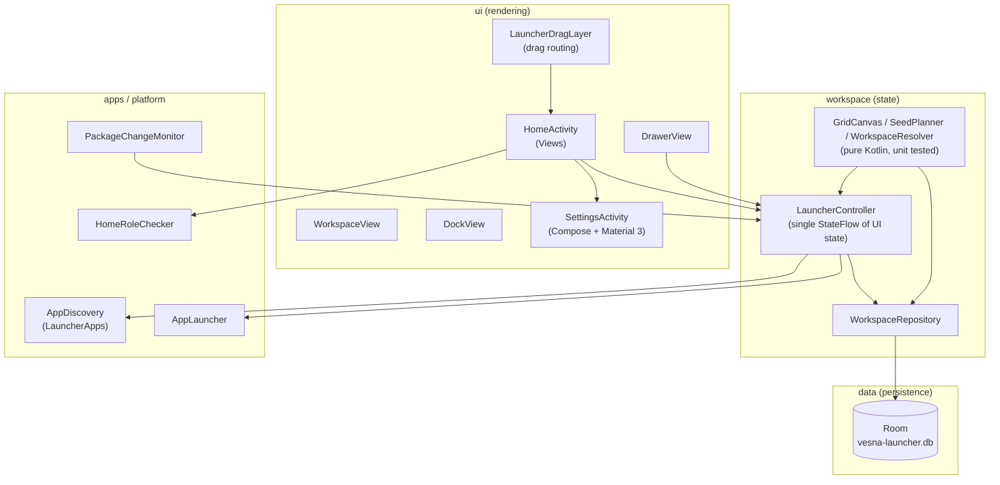

# Architecture Overview

Vesna Launcher (currently 0.4.1) is a single Gradle module (`:app`) with clearly
separated packages. The module split mirrors architectural concerns, not Gradle
boundaries: more Gradle modules are added only when a second build output (e.g. a
shared library) actually exists.

## Package layout

| Package | Concern | Contents |
|---|---|---|
| `platform` | Android system integration | `AppDiscovery` (launchable apps across all profiles via `LauncherApps`), `AppLauncher` (profile-aware launching), `PackageChangeMonitor` (install/update/uninstall events for all profiles), `HomeRoleChecker` (default-home detection and request intents) |
| `apps` | Application discovery model | `AppKey`, `LauncherApp`, `AppSearch` (pure, unit-testable filter behind drawer search) |
| `workspace` | Workspace state | `LauncherController` (UI state + actions), `WorkspaceRepository` (Room-backed layout store), pure logic in `GridCanvas`, `DockOrdering`, `SeedPlanner`, `WorkspaceResolver`; models `WorkspaceItem`, `Folder` (grid cell that auto-dissolves below two members), `CellContent` (what a cell renders: `App` or `FolderCell`), `LauncherMessage` (non-fatal feedback: `WORKSPACE_FULL`, `DOCK_FULL`) |
| `data` | Persistence | Room database, DAO, entity, mappers |
| `ui` | Rendering | `HomeActivity`, `LauncherDragLayer` (root view; routes armed drag sessions), `WorkspaceView`, `DockView`, `DrawerView`, `AppIconView`, `DrawerAppsAdapter`, `FolderDialog` (open-folder grid, rename/remove), `FolderContentsAdapter` |
| `settings` | Settings | `SettingsActivity`, Compose `AboutScreen`, `VesnaTheme` |

## Key decisions

| # | Decision | Rationale |
|---|---|---|
| 1 | Single Gradle module for 0.1.0 | No second artifact exists yet; package separation gives the seams future modules need. Avoids premature build complexity. |
| 2 | Android Views for workspace/drawer/dock; Compose for settings | The launcher hot path (start-up, scrolling) benefits from plain Views; settings screens are static and benefit from Compose + Material 3. |
| 3 | No AppCompat | minSdk 26 ships native vectors and `PopupMenu`; the launcher start path stays lean. |
| 4 | App-scoped state holder (`LauncherController`), not per-activity ViewModels | A launcher process is long-lived; layout state must survive activity recreation (rotation, theme change). State lives in `Application`. |
| 5 | Room for layout persistence | Structured storage of cell placement with flows. API 35 verification covered layout retention after process death and reboot. [VESNA-QA-004](../engineering/BACKLOG.md#vesna-qa-004-migration-and-restart-verification-done) |
| 6 | Manual dependency graph (`LauncherGraph`) | Three singletons do not justify a DI framework. |
| 7 | `LauncherApps` for discovery, `PackageManager` intents for launching | Public API designed for home apps: enumerates the main profile **and managed profiles** (work apps appear badged) and exposes package change events for all profiles. Visibility is granted by the single `<queries>` manifest entry — no `QUERY_ALL_PACKAGES`. Work-profile components launch through `LauncherApps.startMainActivity`; main-profile apps use classic intents so launching works even while Vesna is not the default home. |
| 8 | 4-column grid, 5 workspace rows, 4 dock slots | Dock slots align with workspace columns; grid rules are pure and unit tested. |

## Data flow

1. `VesnaApplication` creates the `LauncherGraph` and starts `PackageChangeMonitor`.
2. `LauncherController` discovers installed apps on `Dispatchers.IO` and keeps a
   `StateFlow<LauncherUiState>` that combines live apps with persisted workspace
   items. A disabled app is hidden but its workspace cell, dock order and folder
   membership are kept. Re-enabling it makes those pins reappear. Only package
   removal for that profile drops its pins and dissolves newly sparse folders.
3. `HomeActivity` collects the state flow while started and renders workspace,
   dock, and drawer.
4. User actions (launch, add/remove from workspace/dock) go through
   `LauncherController`, which mutates Room via `WorkspaceRepository`; flows emit
   the new state. Drag-and-drop reuses this path: `HomeActivity` arms a session,
   the root `LauncherDragLayer` intercepts the touch stream and feeds it to the
   coordinator, and drops commit through the same controller actions.
5. `LauncherApps` package callbacks trigger re-discovery and layout cleanup, so
   installs, updates, and uninstalls appear without restarting the launcher.
6. On the very first run (a persisted "seeded" flag absent), `SeedPlanner` fills
   the dock and first workspace page. An upgraded install with an existing
   layout is adopted as-is; a user-emptied workspace is never re-seeded.

Current main identifies a workspace pin dragged to an empty cell by the
source cell and exact app key. Two pins with the same app key retain their
individual placements. [PR #44](https://github.com/vladon/vesnalauncher/pull/44)

Each folder creation commits the folder row and both membership updates in
one Room transaction. Removing a member also commits its move and any
resulting dissolution together. A failure inside either operation rolls
its writes back. [Folder verification](../engineering/REQUIREMENTS_TRACEABILITY.md#folders)

Room schema 4 stores stable workspace page IDs separately from their display
rank. Top-level workspace items and folders reference a page; folder members
inherit it, and dock pins remain global. Existing layouts migrate to the
default page without rewriting their cell positions.
[ADR-PAGE-1](../adr/0001-workspace-page-identity.md)

## Threading and lifecycle

- Discovery and database access run on `Dispatchers.IO`; UI state is combined in
  the application scope and collected on the main thread.
- `PackageChangeMonitor` registers a `LauncherApps.Callback` on the main looper;
  install/update/uninstall events arrive for all accessible profiles,
  superseding the single-profile `PACKAGE_*` broadcasts.
- `HomeActivity` uses `repeatOnLifecycle(STARTED)` so it never renders or toasts
  while stopped, and `singleTask` + `onNewIntent` closes the drawer when HOME is
  pressed again.
- Icons are `Drawable`s shared by `ConstantState` (`newDrawable()` per bind), so
  views never share one mutable `Drawable` instance.

## Known limitations (0.4.1)

- Fixed single 4×5 workspace page in all orientations; on small landscape heights
  icons shrink. Page management via drag (research candidate `HOME-104`) is not
  implemented — see the engineering roadmap
  ([../engineering/ROADMAP.md](../engineering/ROADMAP.md)).
- Folders exist on the single page, including drag-into-folder: drops onto a
  folder cell route through `LauncherController.addToFolder` (two `HomeActivity`
  paths). That UI flow is source-verified but unverified on device; folder
  pagination is not implemented.
- Icon packs, widgets, themes, and fuzzy search matching are not implemented;
  drawer search is case-insensitive substring only.
- A dedicated backup/restore feature does not exist; the manifest keeps the
  platform `allowBackup` default, whose scope is an open ADR candidate
  ([../engineering/BACKLOG.md](../engineering/BACKLOG.md#adr-backup-1-backup-and-privacy-policy)).

Current verification state and the engineering baseline live in
[../engineering/PROJECT_STATUS.md](../engineering/PROJECT_STATUS.md).
