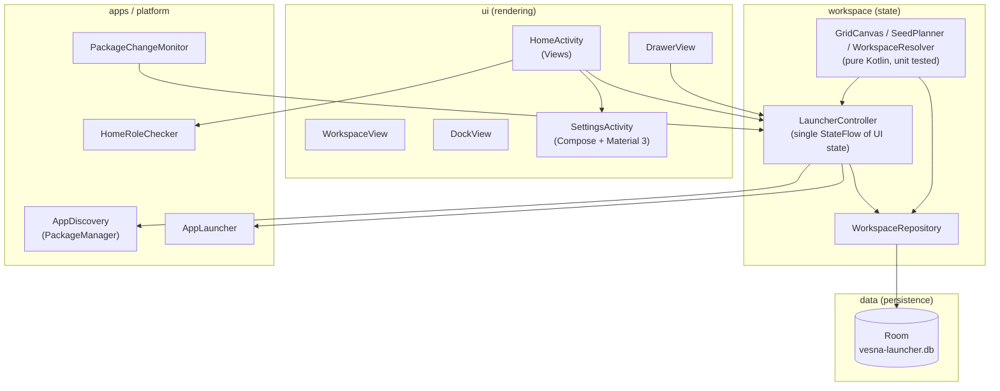

# Architecture Overview

Vesna Launcher 0.1.0 is a single Gradle module (`:app`) with clearly separated
packages. The module split mirrors architectural concerns, not Gradle boundaries:
more Gradle modules are added only when a second build output (e.g. a shared
library) actually exists.

## Package layout

| Package | Concern | Contents |
|---|---|---|
| `platform` | Android system integration | `AppDiscovery` (installed launchable apps via `PackageManager`), `AppLauncher` (start activities), `PackageChangeMonitor` (install/update/uninstall broadcasts), `HomeRoleChecker` (default-home detection and request intents) |
| `apps` | Application discovery model | `AppKey`, `LauncherApp` |
| `workspace` | Workspace state | `LauncherController` (UI state + actions), `WorkspaceRepository` (Room-backed layout store), pure logic in `GridCanvas`, `SeedPlanner`, `WorkspaceResolver`, `WorkspaceItem` |
| `data` | Persistence | Room database, DAO, entity, mappers |
| `ui` | Rendering | `HomeActivity`, `WorkspaceView`, `DockView`, `DrawerView`, `AppIconView`, `DrawerAppsAdapter` |
| `settings` | Settings | `SettingsActivity`, Compose `AboutScreen`, `VesnaTheme` |

## Key decisions

| # | Decision | Rationale |
|---|---|---|
| 1 | Single Gradle module for 0.1.0 | No second artifact exists yet; package separation gives the seams future modules need. Avoids premature build complexity. |
| 2 | Android Views for workspace/drawer/dock; Compose for settings | The launcher hot path (start-up, scrolling) benefits from plain Views; settings screens are static and benefit from Compose + Material 3. |
| 3 | No AppCompat | minSdk 26 ships native vectors and `PopupMenu`; the launcher start path stays lean. |
| 4 | App-scoped state holder (`LauncherController`), not per-activity ViewModels | A launcher process is long-lived; layout state must survive activity recreation (rotation, theme change). State lives in `Application`. |
| 5 | Room for layout persistence | Structured storage of cell placement with flows; restores state after process death and reboot. |
| 6 | Manual dependency graph (`LauncherGraph`) | Three singletons do not justify a DI framework. |
| 7 | PackageManager + `<queries>` manifest entry for app visibility | Public API that works without the restricted `QUERY_ALL_PACKAGES` permission; discovery is isolated behind `AppDiscovery` so a later `LauncherApps` (work profile) implementation can be swapped in. |
| 8 | 4-column grid, 5 workspace rows, 4 dock slots | Dock slots align with workspace columns; grid rules are pure and unit tested. |

## Data flow

1. `VesnaApplication` creates the `LauncherGraph` and starts `PackageChangeMonitor`.
2. `LauncherController` discovers installed apps on `Dispatchers.IO` and keeps a
   `StateFlow<LauncherUiState>` that combines live apps with persisted workspace
   items. Items whose app is no longer installed are filtered from the UI and
   pruned from the database.
3. `HomeActivity` collects the state flow while started and renders workspace,
   dock, and drawer.
4. User actions (launch, add/remove from workspace/dock) go through
   `LauncherController`, which mutates Room via `WorkspaceRepository`; flows emit
   the new state.
5. Package broadcasts trigger re-discovery and layout cleanup, so installs,
   updates, and uninstalls appear without restarting the launcher.
6. On the very first run (a persisted "seeded" flag absent), `SeedPlanner` fills
   the dock and first workspace page. An upgraded install with an existing
   layout is adopted as-is; a user-emptied workspace is never re-seeded.

## Threading and lifecycle

- Discovery and database access run on `Dispatchers.IO`; UI state is combined in
  the application scope and collected on the main thread.
- `PackageChangeMonitor` is registered with `RECEIVER_NOT_EXPORTED`; system
  package broadcasts are still delivered to it.
- `HomeActivity` uses `repeatOnLifecycle(STARTED)` so it never renders or toasts
  while stopped, and `singleTask` + `onNewIntent` closes the drawer when HOME is
  pressed again.
- Icons are `Drawable`s shared by `ConstantState` (`newDrawable()` per bind), so
  views never share one mutable `Drawable` instance.

## Known limitations (0.1.0)

- Fixed 4×5 grid in all orientations; on small landscape heights icons shrink.
- No drag-and-drop rearrangement; placement is add/remove via long-press menus.
- Work-profile apps are not listed (single-user `PackageManager` discovery).
