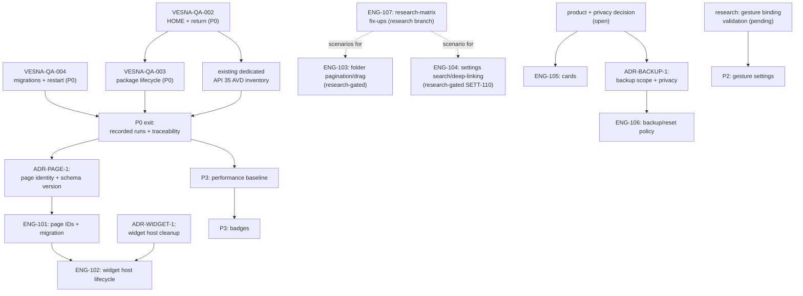

# Engineering Roadmap

Baseline: `888f557` (0.4.1). Current verification state and known gaps are
documented in [PROJECT_STATUS.md](PROJECT_STATUS.md) and
[REQUIREMENTS_TRACEABILITY.md](REQUIREMENTS_TRACEABILITY.md). The authoritative
item list with full descriptions is [BACKLOG.md](BACKLOG.md); this file orders
it by dependency. Item IDs below link into the backlog.

Guiding constraints from the baseline:

- Research requirements beyond the owner-approved QA baseline (order-preservation
  subset of `R-DRAWER-100.4` + local-filtering subset of `R-DRAWER-101.1`) are
  **gated**; roadmap phases consume them only after the research matrix is
  repaired ([RESEARCH_HANDOFF.md](RESEARCH_HANDOFF.md#known-weaknesses-in-the-research-matrix)).
- ADR candidates (page identity/schema migration, widget host cleanup,
  backup/privacy) precede the features that depend on them; see
  [BACKLOG.md](BACKLOG.md#adr-candidates).
- Nothing here implies a product or privacy decision has been made; where one is
  required, it is stated as an open gate.

## P0 — close the riskiest verification gaps (no new features)

Everything in P0 verifies what already ships, on dedicated QA AVDs — the
existing dedicated API 35 AVD for items 1–3, a dedicated API 26 AVD for the
item 4 min-SDK smoke.

1. **[VESNA-QA-002](BACKLOG.md#vesna-qa-002-home-and-launch-return-verification-done) — HOME registration/selection and return-from-app.**
   Status: **done** — recorded run 2026-11-18 on the dedicated API 35 AVD
   ([verification/VESNA-QA-002.md](verification/VESNA-QA-002.md)). A Vesna
   platform baseline item; carries **no approved research ID**. Scope was:
   verify Vesna registers as HOME, can be selected as default, and the user
   returns to the workspace from a launched app; restore the previous HOME
   holder during cleanup; removing the stock launcher is not required. The
   product baseline acceptance (what "HOME works" means for 0.4.1) was
   identified first and is recorded in the verification doc, since no research
   scenario covers this today.
2. **Package removal and temporary unavailability** — uninstall and update/disable
   paths: uninstall removes pins; disabling hides icons without deleting pins
   ([BACKLOG.md](BACKLOG.md#vesna-qa-003-package-lifecycle-verification-partial)).
   Status: **done** — drawer lifecycle verified in VESNA-QA-003A
   (recorded 2026-11-19,
   [verification/VESNA-QA-003.md](verification/VESNA-QA-003.md)).
   [VESNA-QA-003B](verification/VESNA-QA-003B.md) verified placed-item
   behavior on API 35. The remaining device cases are verified:
   [VESNA-QA-003C](verification/VESNA-QA-003C.md) (managed profile: work-only
   uninstall deleted exactly the work-serial placements and left the personal
   package and pin, stable across a launcher restart) and
   [VESNA-QA-003D](verification/VESNA-QA-003D.md) (simultaneous
   workspace/dock/folder removal reconciled after a cold relaunch). The
   dock folder-capacity defect observed in that line (VESNA-BUG-003) was
   fixed in [PR #26](https://github.com/vladon/vesnalauncher/pull/26) and
   device-verified in [VESNA-QA-003E](verification/VESNA-QA-003E.md) (see
   that record for the corrected operational history).
   [VESNA-QA-003F](verification/VESNA-QA-003F.md) verified disabled-app
   pin retention, including re-enable and a cold relaunch.
3. **Migrations and restart** — Room 1→2→3 migration on representative databases,
   layout intact after process death and device reboot
   ([BACKLOG.md](BACKLOG.md#vesna-qa-004-migration-and-restart-verification-done)).
   Status: **done** — migrations device-verified via `RoomMigrationQaTest`
   ([PR #13](https://github.com/vladon/vesnalauncher/pull/13), merge `14ec712`)
   and persistence via [VESNA-QA-004B](verification/VESNA-QA-004B.md)
   (2026-11-19), both on the dedicated API 35 AVD as separate experiments.
4. **Minimum SDK (API 26) smoke** — the declared `minSdk` 26 floor builds,
   installs, cold-starts, and passes the full instrumentation suite on API 26
   ([VESNA-QA-005 in BACKLOG.md](BACKLOG.md#vesna-qa-005-minimum-sdk-api-26-smoke-verification-done)).
   Status: **done** — narrow smoke recorded 2026-11-19 on the dedicated API 26
   AVD ([verification/VESNA-QA-005-API26.md](verification/VESNA-QA-005-API26.md)),
   suite 3/3. [PR #23](https://github.com/vladon/vesnalauncher/pull/23) fixed the dock overlap (VESNA-BUG-004) observed
   during the smoke run. API 26 and API 35 replays verified the fix.

**Exit criteria for P0:** all four QA items have recorded runs (device, build,
result) linked from [REQUIREMENTS_TRACEABILITY.md](REQUIREMENTS_TRACEABILITY.md).

## P1 — structural groundwork and the strongest product candidates

Depends on: P0 green (stable verification base), and research-matrix fix-ups for
any gated ID consumed below.

1. **[ENG-101](BACKLOG.md#eng-101-workspace-page-identities-and-schema-migration): workspace page identities + schema migration.**
   Room version 4 establishes stable page IDs and page-scoped occupancy. The
   launcher still shows the default 4×5 page. Page management via drag
   (research candidate `HOME-104`) is not part of the schema change.
2. **[ENG-102](BACKLOG.md#eng-102-widget-host--lifecycle-only): widget host — lifecycle only.**
   Requires the **widget host cleanup ADR**; widgets occupy grid cells, so it
   builds on ENG-101's identity model. Config-cancel behavior stays out until
   the research `WIDGET-100` gap is resolved.
3. **[ENG-103](BACKLOG.md#eng-103-folder-pagination-and-drag-into-verification): folder pagination and drag-into verification.**
   Pagination is the implementation work; drag-into-folder already exists in
   source (drops onto folder cells route through `addToFolder`) and needs
   on-device verification only. Research-gated: `FOLDER-100`/`FOLDER-101`
   scenarios are missing. No hard dependency on page identities is assumed; if
   the ENG-101 ADR work shows one, it gets recorded in the item with evidence.
4. **[ENG-104](BACKLOG.md#eng-104-settings-search-and-structured-preferences): settings search/deep-linking and structured preferences.**
   Pairs the missing `SETT-110` scenario (research) with a trunk settings
   structure to hang it on. Settings reset is tracked under
   [ENG-106](BACKLOG.md#eng-106-backuprestore-policy) (research `BACKUP-101`).
5. **Product-candidate clusters**, each gated on research scenario authoring and
   explicit approval — listed as candidates, not commitments
   ([CAND-201..207 in BACKLOG.md](BACKLOG.md#candidate-items-unapproved)):
   appearance/theming, essential gestures, icon packs, extended dock/grid/folder
   capacity.

## P2 — product decisions released from the gate

These are decision-blocked, not code-blocked. The decisions are open; this
roadmap only records what unblocks them.

1. **[ENG-105](BACKLOG.md#eng-105-cards-surface): cards surface (`CARDS-100`,
   condition-triggered content).** Blocked on the product/privacy decision —
   location/manual-fallback handling is the open privacy question; notification
   indicators are a separate item; the `DRAWER-105`/`R-DRAWER-103.1` ID reuse
   must be repaired first.
2. **[ENG-106](BACKLOG.md#eng-106-backuprestore-policy): backup/restore policy.**
   The backup/privacy ADR decides whether platform backup stays enabled and
   defines its scope; an explicit backup/restore feature is one option, not a
   given. Reset (research `BACKUP-101`, partial coverage) lands here too.
3. **Gesture settings** (drawer-open configuration): only after live binding-value
   validation lands on the research branch.

## P3 — quality and polish (unblocked but unscheduled)

1. **Performance verification** — Android 15 debug-emulator launch checks
   cover process-cold timing in [VESNA-QA-007](verification/VESNA-QA-007-COLD-START.md)
   and paired cold and warm timing in [VESNA-QA-009](verification/VESNA-QA-009-LAUNCH-STATES.md).
   The [signed 0.4.6 baseline](verification/VESNA-QA-SIGNED-STARTUP.md) covers
   cold, warm, and hot starts on a separate Android 15 emulator. The
   [signed 0.4.7 frame baseline](verification/VESNA-QA-DRAWER-FRAMES.md) covers
   repeat drawer scrolling with 120 fixture entries. The
   [signed 0.4.8 drag baseline](verification/VESNA-QA-DRAG-LATENCY.md) measures
   event delivery to compositor presentation after the drag reaches Home.
   The [signed 0.4.8 first-open baseline](verification/VESNA-QA-DRAWER-FIRST-OPEN.md)
   compares the first populated drawer row after cold launch with a repeat open
   on Android 15. Time to interactivity and physical-device touch-to-display
   latency still need measurement.
2. **API 36.1 verification** — **done**.
   [VESNA-QA-006-API36-1](verification/VESNA-QA-006-API36-1.md)
   (2026-11-19, Windows AVD, Android 16 / API 36.1): instrumentation 5/5 at
   `332fb03`, 7/7 with the integrated BUG-005 candidate at `d8d6a748`, plus
   HOME/launch-return smoke; scope limited to that configuration.
   The [signed follow-up](verification/VESNA-QA-API36-1-SIGNED.md) verified
   an in-place 0.4.9 → 0.4.10 update and current Home and drawer behavior
   on the same AVD configuration without changing the default HOME role.
3. **Badge compatibility** — **done** (2026-11-25): the inconclusive research
   probe re-run as a deterministic checklist on the managed-profile AVDs;
   conclusions recorded in
   [VESNA-QA-BADGE-COMPAT](verification/VESNA-QA-BADGE-COMPAT.md) and
   [RESEARCH_HANDOFF.md](RESEARCH_HANDOFF.md). Any notification-badge FEATURE
   remains #200 (privacy/product gated).
4. **Accessibility, foldables, work-profile UX** — larger-surface candidates
   ([CAND-205..207](BACKLOG.md#candidate-items-unapproved)); unscheduled and
   research-gated like everything else without approval.

## Dependency sketch

Sequencing rules worth restating: verification (P0) precedes features (P1);
ADR candidates precede the feature that depends on them; research-matrix repairs
happen on the research branch **before** trunk consumes a gated ID; and every
shipped change updates [REQUIREMENTS_TRACEABILITY.md](REQUIREMENTS_TRACEABILITY.md)
in the same commit.
